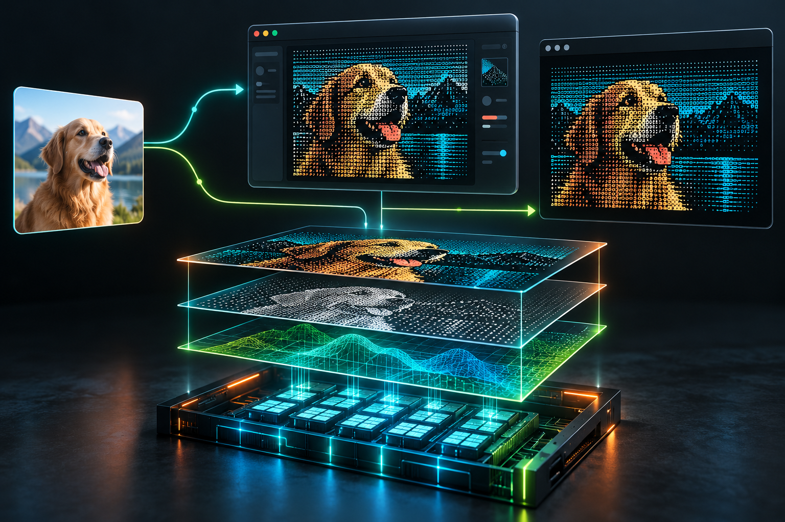
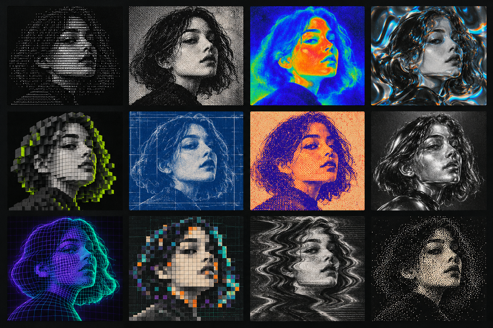
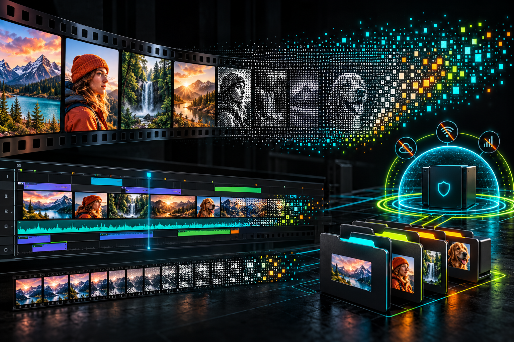

# LocalAscii

<p align="center">
  
</p>

<p align="center">
  <strong>Offline image and video effects studio for Windows, with a local MCP.</strong><br />
  One TypeScript Canvas and WebGL renderer. Zero runtime web dependencies.
</p>

<p align="center">
  <a href="#quick-start">Quick start</a> &nbsp; <a href="#mcp">MCP</a> &nbsp; <a href="#what-it-does">Features</a> &nbsp; <a href="#architecture">Architecture</a>
</p>

---

## Why LocalAscii?

LocalAscii is a creative image and media processor built to run on your machine. Its Electron editor and stdio MCP run the same renderer, so a recipe made by a model can produce the same output in the desktop app.

- Local processing for images, video, and GIFs
- Typed, validated recipes rather than opaque presets
- Canvas and WebGL effects including ASCII, dither, print, glass, thermal, voxel, and more
- Windows desktop editor with live preview and export controls
- MCP tools for image and media automation
- No runtime calls to a website or hosted filter service

<p align="center">
  
</p>

## What It Does

| Surface | Purpose |
| --- | --- |
| **Desktop editor** | Import files, tune a recipe, preview the result, and export locally. |
| **stdio MCP** | Let an MCP client list available filters and render images or media from typed parameters. |
| **Shared engine** | Ensures both surfaces pass through the same Canvas and WebGL rendering path. |

The editor supports PNG, JPEG, WebP, animated GIF, MP4, WebM, MOV, MKV, AVI, and M4V inputs. Video and GIF exports support trim, FPS, scale, and audio options. Existing output files are never overwritten.

<p align="center">
  
</p>

## Quick Start

### Requirements

- Windows 10 or later
- Node.js 20 or later

### Install and launch

```powershell
npm install
npm start
```

`npm start` builds the project and opens the local desktop app. Dependencies are installed during setup only. The app and MCP never fetch filters or codecs at runtime.

### Build and verify

```powershell
npm run build
npm run typecheck
npm test
```

### Package the Windows app

```powershell
npm run package:win
```

The packaged app is written under `releases/`. Keep the generated release directory intact because it includes the local media codecs.

## MCP

Start the stdio server after installation:

```powershell
npm run mcp
```

The server exposes three local tools:

| Tool | Purpose |
| --- | --- |
| `list_filters` | Lists the implemented catalog and recipe controls. |
| `render_image` | Renders a PNG, JPEG, or WebP data URL or an absolute local image path. |
| `render_media` | Renders a local video or animated GIF to MP4, WebM, or GIF. |

Example image request:

```json
{
  "input": "C:\\Media\\portrait.png",
  "recipe": {
    "renderMode": "thermal",
    "thermalSensitivity": 65
  },
  "scale": 1
}
```

Every accepted recipe is validated with Zod. Unsupported modes return an explicit `INVALID_MODE` error instead of silently falling back to another filter.

<p align="center">
  
</p>

## Architecture

```text
Desktop editor ─┐
                ├── TypeScript Canvas + WebGL renderer ── Local files
stdio MCP ──────┘
```

- `src/engine/` contains recipe validation and all rendering paths.
- `src/ui/` contains the desktop editor interface.
- `src/desktop/` contains the sandboxed Electron shell, named pipe worker, and media pipeline.
- `src/mcp/` hosts the local stdio MCP adapter.
- `research/` contains development time reference observations only. It is never a runtime dependency.

FFmpeg handles bounded local media decoding and encoding. Frames stream through the shared renderer sequentially without buffering a whole video in memory.

## Offline By Design

LocalAscii blocks network use at runtime. Inputs are data URLs or absolute local paths, and media probing permits only local file and pipe protocols. Reference comparison tooling exists only for development and is never invoked by the desktop or MCP launchers.

## Current Status

The project has a working desktop editor, local MCP, image pipeline, media pipeline, and a growing implementation of the reference catalog. Filter coverage and visual parity against the original reference remain in active development. Use `list_filters` for the authoritative set of locally implemented modes in your build.

## License

No license has been selected yet. All rights reserved until one is added.
